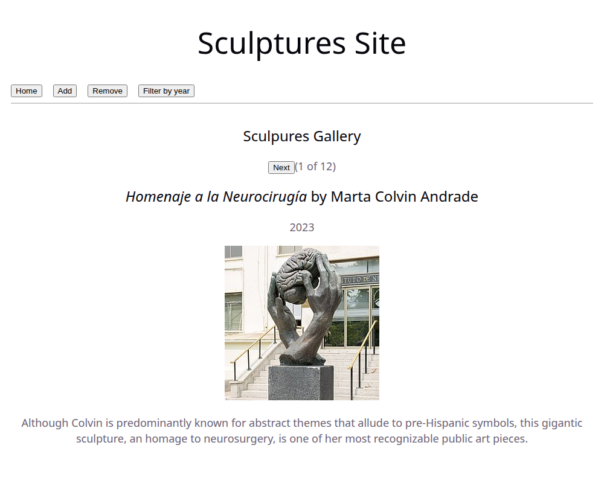
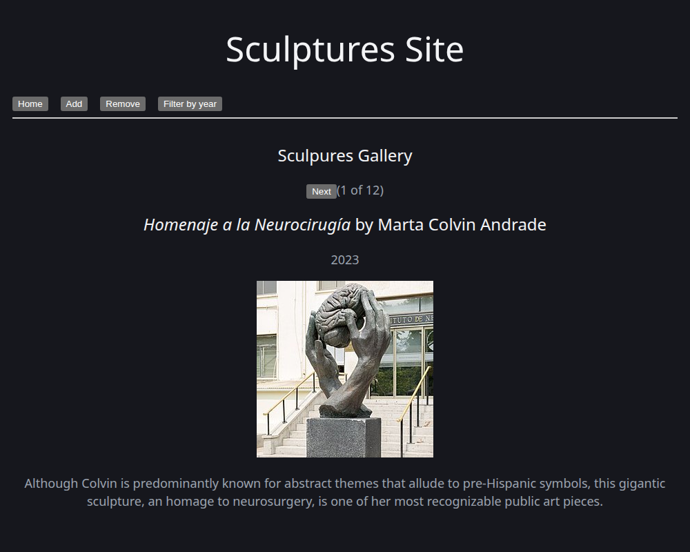
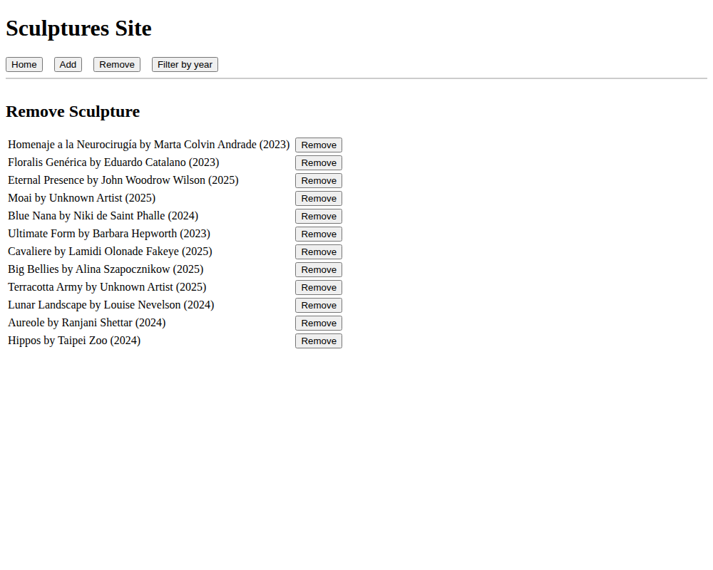

# Minimum CSS

The whole app uses **one CSS file**: `sculptures/src/index.css` (about 50 lines).
It is loaded once in `main.jsx`:

```js
import './index.css'
```

No classes, no frameworks. We only style **HTML tags** (`h1`, `ul`, `table`...) and the `#root` box.

---

## Before / after

On the left, the browser with **no CSS** at all. On the right, the **same page with our CSS**.

| No CSS | With our CSS |
|---|---|
|  |  |

What changed:

- everything is **centered**
- a modern **font** (`system-ui`)
- **softer text color** (grey instead of black)
- headings are **lighter** (not bold)

---

## The rules, one by one

### 1. Colors and font: `:root`

```css
:root {
  --text: #6b6375;
  --text-h: #08060d;
  --bg: #fff;

  font: 18px/1.45 system-ui, sans-serif;
  color-scheme: light dark;
  color: var(--text);
  background: var(--bg);
}
```

- `:root` is the whole page.
- `--text`, `--text-h` and `--bg` are **variables**: we write each color **once** and reuse it.
  - `--text` is the normal text color
  - `--text-h` is the heading color
  - `--bg` is the background
- `font: 18px/1.45 system-ui` sets the text size to 18px with comfortable line spacing, using the computer's own font.
- `color-scheme: light dark` tells the browser that we support both themes, so buttons and inputs also follow the theme.

### 2. Dark mode: `@media (prefers-color-scheme: dark)`

```css
@media (prefers-color-scheme: dark) {
  :root {
    --text: #9ca3af;
    --text-h: #f3f4f6;
    --bg: #16171d;
  }
}
```

If your computer is in **dark mode**, we only **change the 3 variables**.
Everything else updates automatically, because it all uses those variables.

| Light | Dark |
|---|---|
|  |  |

### 3. Remove the page margin: `body`

```css
body {
  margin: 0;
}
```

Browsers add a small margin around the page by default. We remove it.

### 4. The main box: `#root`

```css
#root {
  max-width: 1126px;
  margin: 0 auto;
  padding: 0 1rem;
  text-align: center;
}
```

`#root` is the `<div id="root">` in `index.html` where React draws the app.

- `max-width: 1126px` stops the page getting too wide on big screens.
- `margin: 0 auto` puts the box in the **middle** of the screen.
- `padding: 0 1rem` leaves a little space on the left and right (useful on phones).
- `text-align: center` **centers** all the text inside.

### 5. Headings: `h1`, `h2`

```css
h1,
h2 {
  font-weight: 500;
  color: var(--text-h);
}

h1 {
  font-size: clamp(36px, 5vw, 56px);
}

h2 {
  font-size: 24px;
}
```

- Headings use the **darker** color `--text-h`, so they stand out from the text.
- `font-weight: 500` makes them a bit lighter than the default bold.
- `clamp(36px, 5vw, 56px)` gives a **responsive** title size: never smaller than 36px, never bigger than 56px, and in between it follows the screen width (`5vw` = 5% of the window width).

### 6. Center the table: `table`

```css
table {
  margin: 0 auto;
}
```

`text-align: center` centers **text**, but a `<table>` is a **box**, so it stays on the left.
`margin: 0 auto` centers the box itself. It's the same trick we used for `#root`.

| No CSS | With our CSS |
|---|---|
|  |  |

### 7. Lists without bullets: `ul`

```css
ul {
  list-style: none;
  padding: 0;
}
```

- `list-style: none` removes the bullets (•).
- `padding: 0` removes the space browsers leave on the left for the bullets. Without it, the centered list would sit slightly to the right.

| No CSS | With our CSS |
|---|---|
|  |  |

---

## All the views

| Home | Add |
|---|---|
|  |  |

| Remove | Filter by year |
|---|---|
|  |  |

---

## What we did **not** need

- **No CSS classes** (`className`): styling the tags is enough for this app.
- **No CSS framework** (Bootstrap, Tailwind...).
- **No extra files**: the `App.css` that came with the Vite template was deleted because nothing used it.

The menu bar in `App.jsx` has its own small **inline style** (`style={{ display: "flex", gap: "1rem", ... }}`) that puts the buttons in a row with a line under them.

---

> Screenshots taken from the real app (`npm run dev`) at 1000px wide, using headless Chrome.
